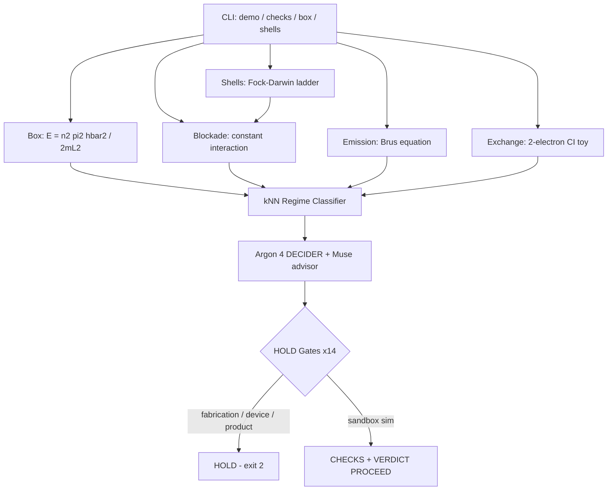
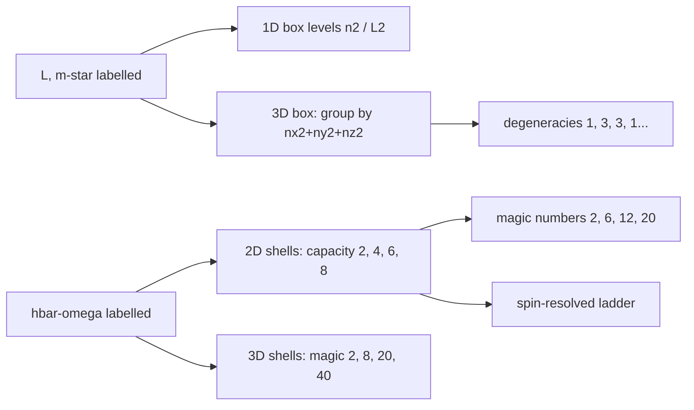
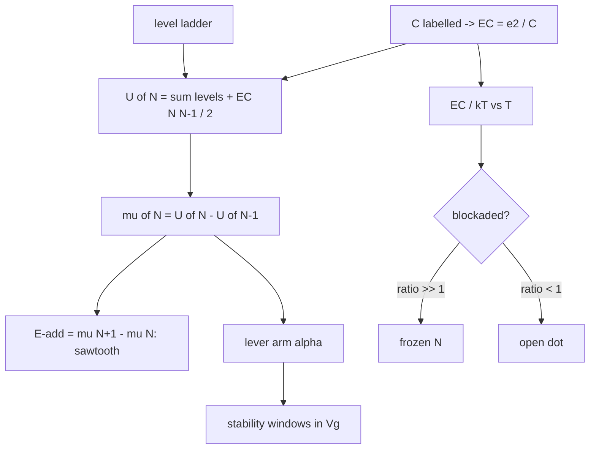
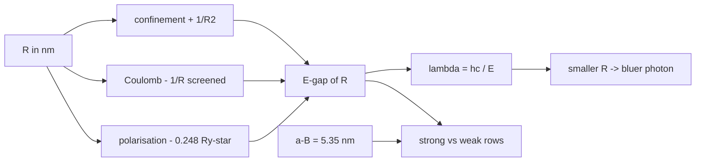
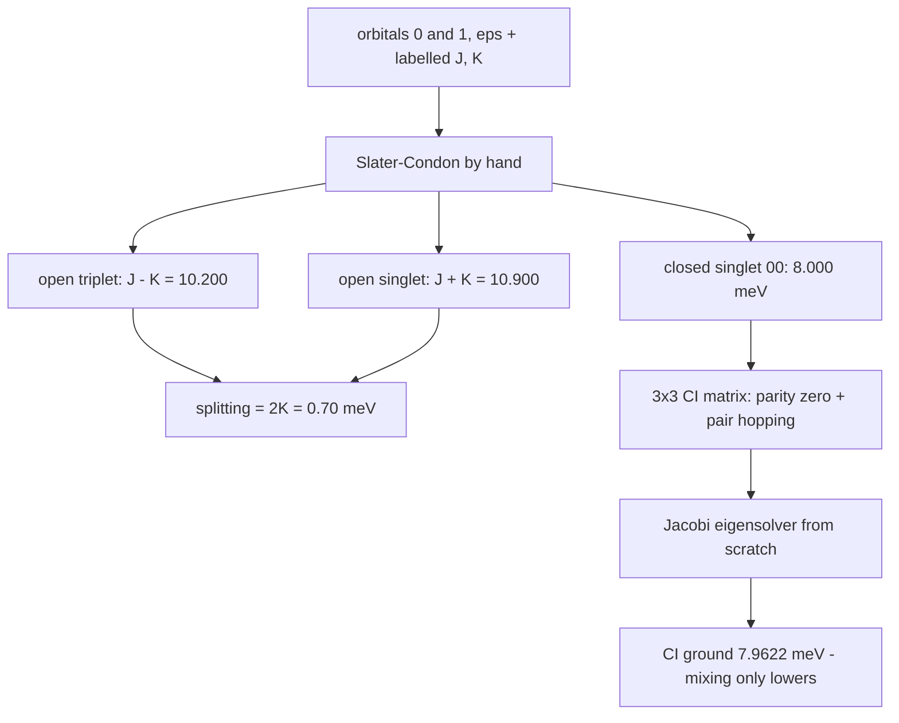
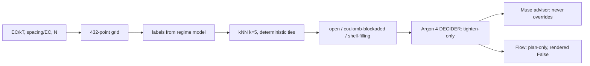
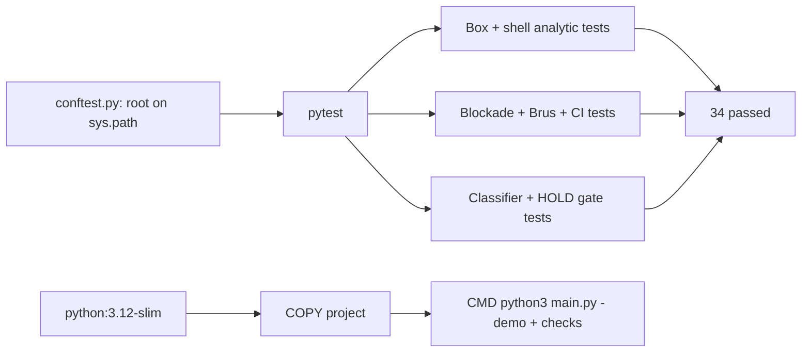

# QuantumDots-Lab ⚛️🔵

**Quantum Dot Confinement + Charging Lab** — by Darion Kellar

QuantumDots-Lab is an **educational quantum-dot lab** in ONE pure-Python file. It builds the physics of an artificial atom from the ground up, with real formulas and labelled parameters:

- **Confinement** — a particle in a 1D/3D box (`E ∝ n²/L²`) and in a 2D/3D harmonic bowl (Fock–Darwin at zero field), where levels bunch into shells with **magic numbers 2, 6, 12, 20** 🔵
- **Charging** — the constant-interaction model: every extra electron pays the level price plus `E_C = e²/C`, producing the **addition-energy sawtooth** and the gate-voltage **stability windows** of Coulomb blockade 🔒
- **Emission** — the **Brus equation**: shrink a CdSe dot and its gap widens, so the emitted photon shifts from 689.6 nm at R = 6 nm to **487.8 nm at R = 2 nm** 🌈
- **Two electrons** — a Slater–Condon miniature: the triplet sits exactly **2K = 0.70 meV** below the open-shell singlet, and a small CI diagonalization (Jacobi solver, from scratch) mixes the singlet configurations ⚖️

Honest scope, stated up front: every parameter is a **LABELLED textbook-class teaching value** (GaAs m\* = 0.067, CdSe gap 1.74 eV, C = 80 aF, ℏω = 3 meV) — **not measured device data**, and no output is a device specification. This lab fabricates, cools, biases, and measures **nothing real**. Every fabrication / device / product claim sits behind a permanent HOLD gate (14 total). 🔒

[](https://github.com/kimanicollier44-cmyk/QuantumDots-Lab/actions/workflows/ci.yml)
[](https://github.com/kimanicollier44-cmyk/QuantumDots-Lab/actions/workflows/docker-publish.yml)

> ℹ️ These are the **live** workflow badges for this repo. They activate as soon as the `ci.yml` and `docker-publish.yml` files from the paste pack are pasted into `.github/workflows/` — until then they have nothing to report yet.

## 🧰 Tech Stack Badges & Full Architecture Tech Stack

### 💻 Core Programming Languages & Core Systems


- 🐍 Python 3.12, pure standard library (`math`, `hashlib`, `json`, `sys`) — zero dependencies, zero network, deterministic (double-run byte-identical)
- 📦 Confinement core: box spectrum `E_n = n²π²ℏ²/(2m*L²)`, harmonic shells `E = ℏω(s + 1)` in 2D / `ℏω(s + 3/2)` in 3D, degeneracies counted from the quantum numbers — every scaling law asserted against its analytic value in CHECKS
- 🔒 Charging core: constant-interaction model `U(N) = Σ εᵢ + E_C·N(N−1)/2` with `E_C = e²/C` computed from SI constants, chemical potentials by finite difference of U(N), stability windows from a labelled lever arm
- 🧮 A from-scratch cyclic **Jacobi eigensolver** diagonalizes the two-electron CI matrix; reconstruction V Λ Vᵀ = A is asserted in CHECKS
- 🧠 TinyML kNN regime classifier (from scratch, stdlib): open / coulomb-blockaded / shell-filling from E_C/kT + spacing/E_C + N, labels from the lab's own regime model
- 🪑 Council seats: Gemini Argon 4 DECIDER (names-only, tighten-only) + Muse advisor (never overrides HOLD) + Google Flow plan-only (rendered = False, live = 0)

### ⛓️ Web3 & Infrastructure

- 🚫 **Not applicable — honestly.** No blockchain, no Web3, no tokens: the "infrastructure" in this lab is a labelled model of one confined electron system inside one offline file. No fake badges here.

### ⚙️ Platform Support & Hardware Architecture


- 🖥️ Pure Python — runs anywhere Python 3.12+ runs (Linux, macOS, Windows), plus the `python:3.12-slim` Docker image
- 🔒 No hardware is controlled, ever: real dots, gate electrodes, and cryostats are permanent HOLD gates (see the gate table below)

### ⚡ Low-Level Infrastructure & Performance

- 🚫 **No low-level code — honestly.** No C, no C++, no GPU, no compiled extensions: this is one interpreted Python file on purpose, so every number can be read, checked, and diffed. Performance here means honest algorithms — closed-form spectra, a finite-difference chemical potential, and a cyclic Jacobi solver — all deterministic and byte-identical between runs.

### 🛠️ DevOps & Build Tools


- 🐳 Docker (`python:3.12-slim`), GitHub Actions CI + Docker Publish (delivered in the paste pack)
- 🎯 Target image: `credkellar/quantumdots-lab:latest`
- 🧪 Tests: `pytest` (34 tests) + the built-in CHECKS suite (64 checks) in `main.py`

### ☁️ Cloud Providers

- 🚫 **None — honestly.** No cloud provider is used or needed: the lab runs fully offline on your own machine or in a local Docker container. Docker Hub appears only as the registry the publish workflow pushes the image to.

## What this does?

1. 📦 **Particle in a box — why size is everything** — the 1D well spectrum `E_n = n²π²ℏ²/(2m*L²)` with a labelled GaAs mass (m\* = 0.067): at L = 10 nm the ground level sits at **56.12 meV** and the 1→2 spacing at **168.37 meV**. Shrink to 5 nm and the spacing quadruples to **673.49 meV**; stretch to 40 nm and it collapses to 10.52 meV. The checks assert the ratio between L and 2L is **exactly 4** — the 1/L² law is the whole reason quantum effects live at the nanoscale.
2. 🗃️ **The 3D box, with degeneracies counted** — levels are grouped by `n_x² + n_y² + n_z²`: the ground state (1,1,1) is alone, the first excited level (2,1,1) is **3-fold degenerate** at exactly 2× the ground energy, (2,2,1) follows at 3×, and (2,2,2) at 4×. Degeneracy is derived from the quantum-number triples, not asserted from a table.
3. 🥣 **Harmonic shells — the artificial atom** — a smooth dot is a bowl, not a box: 2D Fock–Darwin shells at ℏω = 3 meV (LABELLED) hold 2, 4, 6, 8 electrons, so the shell closures land on **2, 6, 12, 20** — the magic numbers of the artificial periodic table. The 3D oscillator's shells give **2, 8, 20, 40**. The spin-resolved ladder [3, 3, 6, 6, 6, 6, 9, …] meV feeds every later section.
4. 🔋 **Charging energy from first principles** — the dot is an island with capacitance C = 80 aF (LABELLED); `E_C = e²/C` is computed from SI constants and lands at **2.0027 meV**. Total energy `U(N) = Σ εᵢ + E_C·N(N−1)/2` counts each pair once, and the chemical potential μ(N) = U(N) − U(N−1) is the honest price of the Nth electron: μ(1) = 3.000 meV (level only), μ(2) = 5.003 meV (level + one pair).
5. 📐 **The addition-energy sawtooth** — E_add(N) = μ(N+1) − μ(N) equals **E_C = 2.003 meV** inside a shell and jumps to **E_C + ℏω = 5.003 meV** at the shell closures N = 2 and N = 6. That sawtooth — flat, flat, spike — is the fingerprint experimentalists actually see in Coulomb-blockade spectroscopy, reproduced here from two terms.
6. 🌡️ **The blockade condition, priced at four temperatures** — blockade needs E_C ≫ kT, and the lab computes the ratio instead of assuming it: **232.41 at 100 mK** (deeply blockaded), **5.53 at 4.2 K** (marginal), **0.30 at 77 K**, **0.08 at 300 K** (wide open — thermal energy dwarfs the charging energy). One dot, four regimes, one ratio each.
7. 💎 **Stability windows — where N cannot change** — with a labelled gate lever arm α = 0.10, each charge state owns a gate-voltage window: **20.0 mV** wide inside a shell, **50.0 mV** at a closure, tiling the axis with no gaps (asserted). These windows are the 1D shadow of the Coulomb diamonds: inside a window, the electron number is frozen; at its edges, two charge states are degenerate and current can flow.
8. 🌈 **Brus emission — smaller dot, bluer photon** — the Brus equation with LABELLED CdSe parameters (gap 1.74 eV, m_e\* = 0.13, m_h\* = 0.45, ε_r = 10.2): gap **2.5417 eV → 487.8 nm** at R = 2 nm, falling monotonically to **1.7979 eV → 689.6 nm** at R = 6 nm, against the bulk 712.6 nm. The exciton Bohr radius (5.35 nm, computed) splits the table into strong- and weak-confinement rows. The model's limits are printed with it: strong-confinement estimate, finite barriers and surface states ignored.
9. ⚖️ **Two electrons — exchange splitting + CI** — Slater–Condon rules in miniature with labelled integrals: the closed-shell singlet |00⟩ costs 2ε₀ + J₀₀ = **8.000 meV**; the open-shell pair splits into triplet **10.200 meV** and singlet **10.900 meV** — exactly **2K₀₁ = 0.70 meV** apart, triplet lower. A 3×3 CI over the singlet configurations (parity makes the |00⟩–|(0,1)S⟩ coupling exactly zero; pair hopping couples |00⟩–|11⟩) is diagonalized by the from-scratch Jacobi solver and lowers the ground state to **7.9622 meV** — mixing can only lower it, and the checks pin the lowering to 0.01–0.10 meV.
10. 🏷️ **Regime classifier + seats + checks** — a from-scratch kNN over a 432-point grid labelled by the lab's own regime model sorts operating points into open / coulomb-blockaded / shell-filling (dilution-fridge N = 2 closure: shell-filling; mid-shell N = 3: coulomb-blockaded; room temperature: open), with Argon 4 DECIDER (sha256 trace), Muse advisor, Google Flow plan-only, and a built-in CHECKS suite (64 checks).

## 🗺️ How it works — diagram per script

### `main.py` — the whole lab



### Box + shells — confinement spectra



### Constant interaction — blockade + stability windows



### Brus emission — size to colour



### Two-electron toy — exchange + CI



### Classifier + council — regimes under HOLD



### `tests/test_main.py` + `conftest.py` + Dockerfile — verification flow



## Why is this cool?

1. 📦 The 1/L² law is **asserted, not narrated**: the checks demand the spacing ratio between L and 2L be exactly 4, so the reason quantum dots must be *nano* is a theorem inside the test suite.
2. 🥣 The artificial periodic table falls out of counting: shell capacities 2, 4, 6, 8 are *derived* from the quantum numbers, and the magic numbers 2, 6, 12, 20 (and 2, 8, 20, 40 in 3D) are what the counting produces.
3. 🔋 The charging energy is computed from **SI constants and one labelled capacitance** — e²/C is not a magic 2 meV typed into the code; change C and the whole blockade story rescales, with the 1/C law asserted.
4. 📐 The addition-energy **sawtooth is the experiment**: flat E_C inside a shell, E_C + ℏω at closures — the same fingerprint measured in real blockade spectroscopy, from a two-term model you can read in one sitting.
5. 🌡️ One ratio runs the whole thermal story: E_C/kT = 232 → 5.5 → 0.3 → 0.08 across 0.1 K → 300 K turns "Coulomb blockade needs a fridge" from folklore into arithmetic.
6. 💎 The stability windows **tile the gate axis with no gaps** — and the tiling is a checked invariant, so the 1D shadow of the Coulomb diamonds is provably consistent, not just drawn that way.
7. 🌈 The Brus table is a **colour dial**: one parameter R sweeps the emission 487.8 → 689.6 nm, and the model prints its own limits (strong confinement only, no surface states) next to the numbers.
8. ⚖️ Exchange is shown as **arithmetic with a sign**: singlet J + K, triplet J − K, splitting exactly 2K — the reason triplets sit lower stops being a slogan.
9. 🧮 The CI section is honest quantum chemistry in miniature: parity zeroes one coupling *by symmetry*, pair hopping mixes the rest, and the variational principle is enforced as a numeric window (lowering between 0.01 and 0.10 meV).
10. 🎯 Deterministic end to end: run it twice, get byte-identical output — a quantum dot you can diff.

## What problems this solves?

1. ❌ **Problem:** "Quantum confinement" is usually explained with a cartoon and no numbers. ✅ **Solution:** The box spectrum is computed at four sizes with the exact 1/L² ratio asserted — the cartoon now has a receipt.
2. ❌ **Problem:** Magic numbers get memorized as trivia (2, 6, 12…) with no origin. ✅ **Solution:** They are produced by counting shell degeneracies from the quantum numbers, in 2D and 3D, inside the checks.
3. ❌ **Problem:** Coulomb blockade is described as "electrons repel" and left there. ✅ **Solution:** The constant-interaction model prices every electron — μ(N), E_add(N), the sawtooth — from U(N) by finite differences.
4. ❌ **Problem:** "Needs millikelvin temperatures" is repeated without a scale. ✅ **Solution:** E_C/kT is tabulated at 0.1 / 4.2 / 77 / 300 K, so the fridge requirement is a ratio you can recompute for any C.
5. ❌ **Problem:** Stability diagrams look like abstract diamonds with no axis meaning. ✅ **Solution:** The windows are generated from μ(N) and a labelled lever arm, with widths that match the addition energies exactly.
6. ❌ **Problem:** QD colour tuning is marketed as magic dust. ✅ **Solution:** The Brus equation shows the three competing terms (confinement, Coulomb, polarisation) and the wavelength each radius actually gives.
7. ❌ **Problem:** Brus-model numbers get quoted as device specs. ✅ **Solution:** Parameters are flagged LABELLED at every use, the strong-confinement limits are printed, and `textbook_model_as_device_spec` is a permanent HOLD gate.
8. ❌ **Problem:** Singlet/triplet splitting is usually asserted from Hund's rules. ✅ **Solution:** It is derived from Slater–Condon miniature rules: the 0.70 meV gap *is* 2K₀₁, with the integrals labelled.
9. ❌ **Problem:** CI is a black box in real packages. ✅ **Solution:** A 3×3 CI you can print, with a from-scratch Jacobi solver whose reconstruction is asserted to 1e-9.
10. ❌ **Problem:** Simulation tools quietly imply a device is next. ✅ **Solution:** 14 named HOLD gates return exit code 2 for every fabrication, device-operation, product, or measured-data claim, forever.

## How to install this?

1. 📋 Clone or download this project folder.
2. 🐍 Make sure Python 3.12+ is installed: `python3 --version`
3. ▶️ Run the full demo + checks (no arguments needed):

```bash
python3 main.py
```

4. 🧪 Run the test suite:

```bash
pip install pytest
python3 -m pytest -q
```

5. 🎛️ Try the other commands:

```bash
python3 main.py checks    # 64 built-in checks
python3 main.py box       # box levels, spacings, 3D degeneracies
python3 main.py shells    # harmonic shells + magic numbers + ladder
python3 main.py blockade  # E_C, addition sawtooth, stability windows
python3 main.py emission  # Brus gap + wavelength vs radius (JSON)
python3 main.py exchange  # two-electron states + CI matrix + ground
python3 main.py classify  # kNN regime classifier report
python3 main.py brains    # Argon 4 + Muse + Flow seats
python3 main.py holds     # list all 14 HOLD gates
python3 main.py hold-demo # exits 2 - gated actions stay HOLD
```

6. 🐳 Or run it in Docker:

```bash
docker build -t credkellar/quantumdots-lab:latest .
docker run --rm credkellar/quantumdots-lab:latest
```

## Requirements

- 🐍 Python 3.12 or newer
- 📦 Dependencies: **none** (standard library only)
- 🌐 Network: **none** — fully offline
- 🧪 For tests only: `pytest`
- 🐳 Optional: Docker

## FULL project structure tree

```text
quantumdots-lab/
├── main.py                  # the whole lab: box, shells, constant interaction, Brus, two-electron CI, classifier, seats, HOLD gates
├── conftest.py              # puts the project root on sys.path for tests
├── tests/
│   └── test_main.py         # 34 pytest tests: box, shells, blockade, Brus, exchange/CI, classifier, gates, determinism
├── assets/
│   └── cover.png            # README cover image (2736 x 912)
├── Dockerfile               # python:3.12-slim, runs the demo + checks
├── .gitignore               # __pycache__/, .pytest_cache/, *.pyc
└── README.md                # this file
```

> 📦 Delivered separately as paste packs (not in this tree): `.github/workflows/ci.yml` + `docker-publish.yml`, and the Docker Hub pack (100-char description, 350-char About, overview, categories).

## 🔒 HOLD gates — all 14, permanent

| # | Gate | What stays held |
|---|------|-----------------|
| 1 | `fabrication_claim` | No fabrication guidance or claim; this lab grows, etches, and deposits nothing |
| 2 | `real_device_control` | No control of a real quantum dot, gate electrode, or cryostat |
| 3 | `material_synthesis_guidance` | No synthesis recipes for quantum-dot materials or precursors |
| 4 | `single_electron_product_claim` | No single-electron transistor product, yield, or reliability claim |
| 5 | `qubit_performance_claim` | No qubit coherence, fidelity, or readout claim from a textbook model |
| 6 | `display_product_claim` | No QD display brightness, lifetime, or product claim |
| 7 | `medical_imaging_claim` | No medical imaging, bio-labelling, or in-vivo claim for any dot |
| 8 | `solar_product_claim` | No solar-cell efficiency or product claim from the Brus model |
| 9 | `cryogenic_operation_live` | No live cryogenic operation directed from a simulation |
| 10 | `gate_voltage_live_application` | No applying gate or bias voltages to real hardware |
| 11 | `measured_device_data_claim` | Simulated numbers must never be presented as measured device data |
| 12 | `investment_claim` | No investment claim; a teaching model is not a prospectus |
| 13 | `patent_claim` | No patentability or novelty claim for textbook models |
| 14 | `textbook_model_as_device_spec` | Labelled parameters must never be presented as a real device's specification |

🧑‍⚖️ **Council seats:** Gemini Argon 4 Extended Thinking — DECIDER (names-only, tighten-only, MAP → MODEL → STRESS → DECIDE, sha256 trace, `can_override_hold = False`) · Muse — advisor (`can_override_hold = False`) · Google Flow — plan-only (`rendered = False`, `live = 0`).

✅ **Verification:** pytest **34 passed** (project + clean copy) · built-in CHECKS **64/64** · double-run output **byte-identical** · `hold-demo` exits **2** · `main.py` **897 lines**, pure stdlib, zero network.

## 🧒 5th-grade English section

Imagine the world's smallest bucket — so small it can hold only a few drops, and the drops are electrons. 🪣

- Squeeze the bucket smaller and the drops inside get **more spread out in energy** — like how a short guitar string makes a higher note than a long one. This lab does that math: make the dot half as wide and the energy steps get **four times** bigger. 🎸
- The bucket fills in **teams**: first 2 electrons, then 6, then 12. Those team sizes (2, 6, 12) are called magic numbers, and the lab counts exactly why. 🔢
- Each new electron has to **pay a toll** to squeeze in next to the others. If the room is warm, the electrons jiggle so much they hop the toll gate — so scientists freeze the dot almost to the coldest cold there is, and the toll gate works. 🥶
- Shrink a glowing dot and its colour changes — big dots glow red, small dots glow blue, like a row of Christmas lights sorted by size. The lab computes the exact colour for each size. 🌈
- Two electrons in the bucket can team up in two ways, called **singlet** and **triplet**, and one team always costs a little less energy. The lab shows the price difference with real numbers. ⚖️
- This project is a **pretend lab on a computer**. It does not make a real quantum dot. It helps you learn why the tiniest buckets in the world behave so strangely. 💻

---

MIT © 2026 Darion Kellar · QuantumDots-Lab — educational simulation only 🔵
